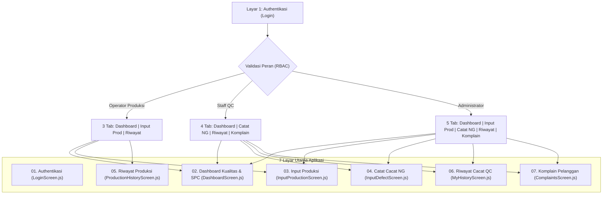

# DESIGN SYSTEM & UI/UX ARCHITECTURE SPECIFICATION
## QC & Production Monitoring Handheld (`qc-mobile-operator`)
**PT Galaxy Mandiri Perkasa — Industrial Stamping & Manufacturing Plant**
*Version: 2.5 (Fully Synchronized with Current Mobile App Implementation)*

---

## 1. PENDAHULUAN & USER PERSONA

### 1.1 Visi Desain & Ekosistem Aplikasi
Aplikasi seluler **`qc-mobile-operator`** (React Native + Expo) dirancang untuk mentransformasi operasional pencatatan kendali mutu (*Quality Control*) dan keluaran produksi mesin (*Production Output*) di lantai pabrik (*shop floor*) PT Galaxy Mandiri Perkasa. Aplikasi menggantikan metode manual berbasis formulir kertas menjadi eksekusi digital genggam yang presisi, cepat, dan terpercaya (*real-time & paperless*).

Aplikasi mengadopsi estetika **Industrial Modern Slate & Steel Blue** (terinspirasi dari standar Linear, Vercel Enterprise, dan Bento Grid 21st.dev), memadukan ketegasan disiplin manufaktur otomotif Jepang (*Monozukuri & Statistical Process Control*) dengan antarmuka digital modern kelas dunia.

### 1.2 Profil Pengguna Utama (Target Persona)
Desain antarmuka secara spesifik dioptimalkan untuk karakteristik demografis dan lingkungan kerja fisik di PT Galaxy Mandiri Perkasa:
- **Demografi**: Staf QC dan Operator Mesin didominasi oleh personel senior/matang (**usia 38–55 tahun**).
- **Faktor Ergonomi Mata (Presbiopia)**: Penurunan daya akomodasi mata alami pada usia 40+ tahun membutuhkan tipografi yang besar, kontras tajam memenuhi standar WCAG AAA, hierarki visual bersih, dan pencegahan efek kelelahan mata (*visual fatigue*).
- **Kondisi Fisik Kerja**:
  - Mengoperasikan ponsel dalam kondisi tangan memakai **sarung tangan kerja pabrik** (bahan katun / *PU-coated gloves*).
  - Bekerja di dekat deretan 29 mesin cetak logam (*metal stamping press* 25T–300T, welding, & assembly) dengan pencahayaan bengkel bervariasi, debu industri, dan kebisingan mesin.
  - Membutuhkan antarmuka yang cepat (*fast-tap*), minim ketukan salah (*fat-finger proof*), dan bebas dari elemen dekoratif yang tidak fungsional.

---

## 2. PRINSIP UTAMA DESAIN (CORE DESIGN PRINCIPLES)

```
       +-------------------------------------------------------------------+
       |                 5 PILAR DESAIN QC-MOBILE OPERATOR                 |
       +-------------------------------------------------------------------+
       | 1. Presbyopia-Friendly Typography (Font >= 12px, KPI Hero 28px)   |
       | 2. Responsive Screen Adaptation (Damping Scaling Engine)          |
       | 3. Monochromatic Number Discipline (Bebas Rainbow Clutter)        |
       | 4. Glove-Friendly Touch Targets (Min Hit 46-56px, Stepper 52x52)  |
       | 5. Unified Scrollable Layout (ListHeaderComponent Architecture)   |
       +-------------------------------------------------------------------+
```

### 2.1 Presbyopia-Friendly Typography (Tipografi Ramah Mata)
- **Aturan Baku**: **TIDAK ADA HURUF MIKRO DI BAWAH 12px** di seluruh aplikasi.
- Seluruh angka metrik KPI dibuat mencolok dengan ukuran dasar **28px (Font Weight: `900`)** sehingga tetap terbaca jelas dari jarak lengan kerja (60–80 cm) saat ponsel diletakkan di dudukan mesin atau dipegang satu tangan.
- Keterangan penjelas, tanggal, dan label sekunder berukuran minimal **12px–13px** dengan kontras tinggi (*high-contrast ratio*).

### 2.2 Responsive Screen Adaptation Engine (Penskalaan Otomatis Layar)
*Diimplementasikan pada: `src/theme/responsive.js` & `src/theme/typography.js`*
- Aplikasi memiliki mesin penskalaan adaptif berbasis baseline resolusi acuan **375 × 812 pt**:
  - `scale(size)`: Penskalaan horizontal proporsional untuk lebar elemen dan margin.
  - `verticalScale(size)`: Penskalaan vertikal untuk tinggi kartu dan pemisah seksi.
  - `moderateScale(size, factor = 0.4)`: Penskalaan dengan faktor peredam (*damping factor* 0.4) khusus untuk ukuran font, border radius, dan tombol.
- **Perilaku di Berbagai Ukuran HP**:
  - **Layar Compact ($\le 360\text{px}$)** (Samsung Galaxy A/M series, Redmi, Oppo, Vivo): Font mengecil secara terkontrol (~1px) dan padding berkurang otomatis ~18% melalui fungsi `spacing()`, sehingga teks dan tombol tidak terpotong (*no clipping/truncation*).
  - **Layar Standard (375px–410px)** (iPhone 14/15, Galaxy S series): Skala 100% ideal sesuai grid desain.
  - **Layar Large ($\ge 414\text{px}$)** (Galaxy S Ultra, iPhone Pro Max): Font membesar proporsional (~1.5px) memanfaatkan bidang layar yang luas.

### 2.3 Monochromatic Number Discipline (Disiplin Warna Angka)
- **Aturan Baku**: Seluruh nilai angka metrik kartu wajib menggunakan warna monokromatik tegas **`textPrimary`** (`#F8FAFC` pada Dark Mode / `#0F172A` pada Light Mode).
- Label kategori dan satuan (`pcs`, `%`, `Target`) menggunakan warna **`textSecondary`** (`#94A3B8` / `#475569`).
- Warna semantik (**Emerald Green `#10B981`**, **Crimson Red `#EF4444`**, **Amber Orange `#F59E0B`**) **HANYA** boleh diaplikasikan pada:
  1. Lencana status kecil (*Status Badge Pills*, contoh: "IN-CONTROL", "Target Tercapai").
  2. Garis batang progres (*Progress Bar Track & Fill*).
  3. Garis batas statistik diagram kendali SPC (UCL Merah, CL Biru, LCL Hijau).

### 2.4 Glove-Friendly Touch Targets (Target Sentuh Sarung Tangan)
- Tombol aksi utama, tab segment, chip pemilih cacat, dan dropdown selector memiliki tinggi minimal **46px – 56px**.
- Tombol stepper kuantitas ($+$ dan $-$) berukuran **52px × 52px** dengan jarak sela (*gap*) minimal **12px** untuk mencegah salah tekan saat memakai sarung tangan kerja tebal.
- Setiap tombol interaktif menggunakan `SpringButton` yang memberikan umpan balik taktil animasi pegas (*spring scale 0.96*).

### 2.5 Unified Scrollable Layout Architecture (Arsitektur Header Ter-scroll)
- Pada layar daftar rekaman beruntun (**Riwayat Produksi** dan **Riwayat Cacat QC**), komponen header, tab filter periode harian/mingguan, search bar, dan ribbon ringkasan efisiensi **terintegrasi langsung ke dalam `ListHeaderComponent` milik FlatList**.
- **Keunggulan**: Seluruh header ikut ter-scroll ke atas saat daftar digulir, membuka ruang layar maksimum (*vertical real estate*) untuk membaca lebih banyak baris data tanpa terhalang elemen statis yang memakan tempat.

---

## 3. SISTEM TOKEN DESAIN (DESIGN TOKENS)

### 3.1 Palet Warna Resmi (Official Slate & Steel Blue Color System)
*Diimplementasikan pada: `src/theme/colors.js`*

| Token Warna | Nilai Dark Mode | Nilai Light Mode | Peruntukan Fungsional |
|:---|:---:|:---:|:---|
| `background` | `#090D16` | `#F8FAFC` | Latar belakang kanvas kanonik aplikasi |
| `card` | `#0F172A` | `#FFFFFF` | Latar kartu Bento, modal sheet, dan container form |
| `cardSubtle` | `#1E293B` | `#F1F5F9` | Latar sekunder, search bar, dan ribbon mini KPI |
| `border` | `#1E293B` | `#E2E8F0` | Garis pembatas kartu, input, dan divider |
| `borderFocused` | `#3B82F6` | `#2563EB` | Garis tepi saat input teks atau kartu aktif |
| `textPrimary` | `#F8FAFC` | `#0F172A` | Judul, angka metrik utama, nilai input form |
| `textSecondary`| `#94A3B8` | `#475569` | Label kolom, subjudul kartu, satuan metrik |
| `textMuted` | `#64748B` | `#94A3B8` | Placeholder, tanggal sekunder, informasi footer |
| `primary` | `#3B82F6` | `#2563EB` | Aksi utama, brand identity, CL garis SPC |
| `success` | `#10B981` | `#10B981` | Status "IN-CONTROL", "Target Tercapai", LCL limit |
| `critical` | `#EF4444` | `#EF4444` | Status "OUT-OF-CONTROL", "Below Target", UCL limit |
| `warning` | `#F59E0B` | `#F59E0B` | Peringatan toleransi, temuan mayor, status lokal offline |
| `purple` | `#8B5CF6` | `#7C3AED` | Aksen peran Administrator, badge customer luar |
| `aiAccent` | `#6366F1` | `#4F46E5` | Aksen rekomendasi AI Random Forest |

### 3.2 Skala Tipografi Responsif (Responsive Typography Scale)
*Diimplementasikan pada: `src/theme/typography.js`*

```javascript
typography = {
  sizes: {
    kpi: ms(28),            // Hero KPI numbers (Weight: 900, LineHeight: 34px)
    h1: ms(22),             // Judul halaman utama (LineHeight: 28px)
    h2: ms(19),             // Judul seksi & subheader grafis (LineHeight: 24px)
    h3: ms(17),             // Judul kartu besar (LineHeight: 22px)
    screenHeading: ms(19),  // Header atas layar
    cardHeading: ms(16),    // Nama mesin, judul kartu (Weight: 700, LineHeight: 22px)
    body: ms(14),           // Teks konten, nilai form, item dropdown (Weight: 400/700)
    caption: ms(13),        // Subjudul, catatan inspeksi, filter (LineHeight: 18px)
    micro: ms(12),          // Lencana status, label chip (Weight: 700, LineHeight: 16px)
    tabLabel: ms(12),       // Label navigasi bilah bawah
  }
}
```

### 3.3 Sistem Radius & Elevasi
```
+-----------------------------------------------------------------------+
| Token Radius | Ukuran | Penggunaan Fungsional                         |
+-----------------------------------------------------------------------+
| radius-sm    | 6px    | Lencana status mini, tag part number          |
| radius-md    | 8-10px | Chip filter cacat, tombol tab periode         |
| radius-lg    | 12-14px| Kolom input teks, stepper kuantitas           |
| radius-xl    | 16-18px| Kartu Bento, kartu mesin, dialog konfirmasi   |
| radius-2xl   | 24px   | Lembar modal bawah (Bottom Sheet), PhotoModal |
| radius-full  | 999px  | Progress bar, avatar bulat, status pill ticker|
+-----------------------------------------------------------------------+
```

---

## 4. ARSITEKTUR NAVIGASI & ROLE-BASED ACCESS CONTROL (RBAC)

### 4.1 Header Aplikasi Global (`AppHeader.js`)
Header industrial seragam yang muncul di bagian atas seluruh layar aplikasi dengan fitur:
- **Avatar Inisial Dinamis**: Inisial 2 huruf (contoh: "AQ" untuk Administrator QC).
- **Identitas Pabrik**: Label eyebrow `PT GALAXY MANDIRI PERKASA` dan nama lengkap pengguna.
- **Lencana Peran**: Pill peran berlatar aksen (*Operator / Staff QC / Admin*).
- **Pulsating Status Ticker**: Indikator koneksi dengan animasi *breathing pulse loop* berkedip halus hijau bertuliskan `ONLINE`.
- **Theme Switcher**: Tombol ikon matahari/bulan dengan animasi rotasi pegas halus (*spring rotation*).
- **Akses Modal Cepat**: Ketukan pada header membuka *Change Password Modal*, *Operator Profile & Shift Context Modal*, atau *Logout Confirm Modal*.

### 4.2 Bilah Navigasi Bawah Mengambang (`CustomTabBar.js`)
Bilah navigasi bawah dirancang adaptif berdasarkan peran pengguna (*Role-Based Access Control*):

| Peran Pengguna | Jumlah Tab | Komposisi Tab Navigasi |
|:---|:---:|:---|
| **Operator Produksi** | **3 Tab** | 1. Dashboard &bull; 2. Input Prod &bull; 3. Riwayat Produksi |
| **Staff QC** | **4 Tab** | 1. Dashboard &bull; 2. Catat NG &bull; 3. Riwayat Cacat &bull; 4. Komplain |
| **Administrator** | **5 Tab** | 1. Dashboard &bull; 2. Input Prod &bull; 3. Catat NG &bull; 4. Riwayat (Dual Switcher) &bull; 5. Komplain |

*Catatan Khusus Admin*: Pada menu ke-4 (*Riwayat*), Administrator dilengkapi **Dual-History Segmented Switcher** (`[Produksi]` vs `[Cacat NG]`) di bagian atas layar sehingga tidak membutuhkan tab terpisah yang mempersempit bilah navigasi.

### 4.3 Diagram Alur Navigasi Aplikasi



---

## 5. SPESIFIKASI RINCI 7 LAYAR UTAMA (DETAILED SCREEN SPECIFICATIONS)

### 5.1 Layar 01: Authentikasi & Login (`LoginScreen.js`)
- **Tujuan**: Autentikasi aman personel pabrik dengan proteksi kesalahan input.
- **Elemen Antarmuka**:
  - Logo Terminal QC & Branding resmi PT Galaxy Mandiri Perkasa.
  - Input Username dan Password terproteksi dengan toggle visibilitas (*Eye icon*).
  - Sakelar penyimpanan kredensial akun aman (*Remember Me* via SecureStore / AsyncStorage).
  - Tombol masuk industrial penuh (`SpringButton`) dengan status loading terintegrasi.
  - Sakelar tema (*Dark Mode / Light Mode*) langsung di halaman awal.
  - Modal penanganan kesalahan kredensial (*LoginErrorModal*).

### 5.2 Layar 02: Dashboard Kualitas & Statistik SPC (`DashboardScreen.js`)
- **Tujuan**: Ringkasan eksekutif live performa mutu manufaktur dan pengendalian variasi proses.
- **Komponen Utama**:
  1. **4 Kartu Metrik Kualitas (Bento KPI Grid 2×2)**:
     - *Total Produksi*: 112.022 pcs (Lencana: "Seluruh Lini Pabrik").
     - *Total NG / Defect*: 1.364 pcs (Lencana: "1.364 pcs pabrik").
     - *Defect Rate*: 1.22% (Lencana: "Target Pabrik Tercapai").
     - *Komplain Customer*: 0 kasus (Lencana: "Zero Complaint").
  2. **Pemilih Periode Waktu Segmented**:
     - Pilihan instan: `Hari Ini` | `Kemarin` | `Rentang Tanggal`.
     - Pilihan "Rentang Tanggal" membuka modal interaktif kalender ganda (`CalendarRangeModal`).
  3. **Grafik Kendali Mutu SPC (p-Chart 3-Sigma)**:
     - Status real-time: Lencana hijau `IN-CONTROL` atau merah `OUT-OF-CONTROL`.
     - Bilah batas kendali 3-Sigma: **UCL: 2.45%** (merah putus-putus), **CL ($\bar{p}$): 1.22%** (biru solid), **LCL: 0.00%** (hijau putus-putus).
     - Kanvas kurva SVG vektor tren 7 hari dengan titik data, lingkaran sorotan anomali, dan koordinat tanggal (24/10 s/d 30/10).
     - **Stratifikasi Cacat Utama (Filter Drilldown Pills)**: Tombol pill seleksi interaktif `ALL (1.364)`, `Burry (342)`, `Dent (285)`, `Scratch (210)` untuk mengisolasi kurva per cacat.
     - **Banner Rekomendasi Solusi AI**: Rekomendasi mitigasi berbasis model Random Forest (`RfModal.js`).
  4. **Status Mesin Harian**:
     - Daftar kartu 29 mesin dengan rincian Target, Gross, NG, Net OK, dan bilah toleransi batas 2.0%.

### 5.3 Layar 03: Input Produksi Harian (`InputProductionScreen.js`)
- **Tujuan**: Perekaman data keluaran mesin per shift kerja secara cepat dan akurat.
- **Elemen Antarmuka**:
  - Pemilih Shift Kerja: Shift 1 (Pagi), Shift 2 (Siang), Shift 3 (Malam).
  - Pemilih Mesin Stamping: Bottom sheet modal dengan pencarian instan 29 mesin cetak logam.
  - Pemilih Nomor Part: Bottom sheet modal mencakup 121 nomor part aktif dengan kode spesifikasi plat.
  - Pemilih Jenis Proses: Blanking, Piercing, Bending, Drawing, Spot Welding, Robot Welding, ED Coating, Sub-Assembly, Final Visual Check.
  - Kolom input kuota target dan hasil aktual dengan meteran pencapaian (*Live AchievementMeter*).
  - Tombol Batch Multi-Mesin untuk input simultan beberapa mesin dalam satu lini.

### 5.4 Layar 04: Catat Cacat Produk / NG (`InputDefectScreen.js`)
- **Tujuan**: Formulir inspeksi mutu shop-floor real-time dengan bukti foto dan ketertelusuran ISO.
- **Elemen Antarmuka**:
  - Pemilih Tanggal & Shift Inspeksi (`CalendarDateModal`).
  - **Ketertelusuran ISO 9001:2015**: Pemilihan Operator Lini penanggung jawab lot produksi yang sedang diperiksa.
  - Pemilih Part Number & Mesin Terkait.
  - Chip Kategori Cacat: Burry, Dent, Scratch, Crack, Deformasi, Pin Hole, Rust/Karat.
  - **Stepper Kuantitas Taktil**: Tombol minus $(-)$ dan plus $(+)$ berukuran **52px × 52px** dengan angka display raksasa **32px Weight 900**.
  - **Modul Kamera & Foto Inspeksi**: Tombol tangkap foto kamera / galeri dengan kompresi otomatis WebP/JPEG (`PhotoModal.js`) dan pratinjau thumbnail.
  - Modal Konfirmasi Cacat sebelum penyimpanan permanen (`ConfirmDefectModal.js`).

### 5.5 Layar 05: Riwayat Produksi Operator (`ProductionHistoryScreen.js`)
- **Tujuan**: Log rekapitulasi hasil cetak mesin, target, dan efisiensi yield operator.
- **Elemen Antarmuka**:
  - **Arsitektur Header Ter-scroll** (`ListHeaderComponent`).
  - Tab Filter Periode: `Hari Ini` | `7 Hari` | `Semua`.
  - Kolom Pencarian Instan: Cari berdasarkan nomor mesin, kode part, proses, atau shift.
  - **KPI Summary Ribbon**: 4 kolom metrik terpadu (Gross, NG, Net OK, dan persentase Efisiensi Yield).
  - Kartu Riwayat Mesin: Menampilkan jam kerja, part number, proses, dan status pencapaian target.

### 5.6 Layar 06: Riwayat Cacat QC (`MyHistoryScreen.js`)
- **Tujuan**: Rekapitulasi temuan cacat lot produksi, parameter mesin, dan foto inspeksi.
- **Elemen Antarmuka**:
  - **Admin Dual Switcher**: Sakelar khusus akun Admin untuk beralih antara rekaman `[Produksi]` dan `[Cacat NG]`.
  - Arsitektur Header Ter-scroll (`ListHeaderComponent`).
  - Tab Filter Periode: `Hari Ini` | `7 Hari` | `Semua`.
  - Kotak Pencarian Real-Time.
  - **Mini Summary Ribbon**: Total NG, Jumlah Kasus, Kasus Kritis, dan Mesin Terdampak.
  - **Kartu Cacat Bertingkat (Zero Truncation)**: Rincian parameter mesin, part, jumlah NG, label klasifikasi (*Major / Critical*), remarks analis, serta **Dual Sign-Off Badge** (Operator Lini vs QC Inspector Badge).
  - Pratinjau Foto Layar Penuh saat thumbnail bukti ditekan.

### 5.7 Layar 07: Komplain Pelanggan (`ComplaintsScreen.js`)
- **Tujuan**: Monitoring isu mutu eksternal, klaim garansi pelanggan, dan pencegahan cacat berulang.
- **Elemen Antarmuka**:
  - Lencana Pelanggan Luar Pabrik: Badge ungu profesional (PT Honda Precision, PT Toyota Motor, dsb.).
  - Lencana Status Klaim: `High / Open` (Merah), `Investigation` (Kuning), `Closed` (Hijau).
  - Peringatan Mitigasi Cacat Berulang pada nomor part berisiko tinggi.
  - Catatan tindakan korektif dan penanggung jawab tindak lanjut.

---

## 6. STANDAR AKSESIBILITAS (A11Y), POKA-YOKE & OFFLINE RESILIENCE

1. **Pencegahan Kesalahan Input (Poka-Yoke Manufaktur)**:
   - Nilai kuantitas input dibatasi secara logis (kuantitas NG tidak boleh melebihi total produksi kotor; nilai minus otomatis diblokir).
   - Terdapat konfirmasi visual langsung (*Live Achievement Meter*) saat operator memasukkan kuantitas target dan aktual.
2. **Umpan Balik Haptik & Sentuhan (Sensory Feedback)**:
   - Seluruh tombol utama menggunakan `SpringButton` yang memberikan umpan balik skala animasi (*scale spring down to 0.96*) saat tombol ditekan sehingga operator yang memakai sarung tangan merasakan kepastian bahwa sentuhan telah teregister.
3. **Integritas Sinkronisasi Offline (Network Resilience)**:
   - Status koneksi data disajikan transparan menggunakan lencana status:
     * Lencana **`Cloud`** hijau: data tersimpan aman di server database pusat.
     * Lencana **`Lokal`** kuning dengan ikon jam: data tersimpan di memori offline perangkat (`AsyncStorage/SQLite`) dan siap disinkronisasikan otomatis saat jaringan terhubung kembali.

---

## 7. STANDAR INTEGRASI FIGMA & VECTOR PRESENTATION KIT

Untuk keperluan presentasi akademik, evaluasi sistem mutu, dan serah terima tim pengembang, antarmuka aplikasi diekspor ke dalam format siap-Figma:

### 7.1 Spesifikasi Frame Figma
- **Device Frame Preset**: `iPhone 14 & 15 Pro` (**390 × 844 pt**).
- **Resolusi Tangkapan Layar**: `@3x Retina` (**1170 × 2532 px**).
- **Corner Radius Frame**: `44px` atau `48px`.

### 7.2 Standar Berkas Vector SVG (100% Editable)
Semua 7 layar telah dikonversi menjadi berkas vector `.svg` murni yang tersimpan di `presentation/figma-svg/`:
- **Native Text Layers**: Menggunakan font *Plus Jakarta Sans* dan *JetBrains Mono*, teks angka dan label tidak di-rasterisasi sehingga dapat langsung diklik ganda dan diedit di Figma.
- **Semantic Layer Grouping**: Elemen dikelompokkan secara hierarkis (`StatusBar`, `AppHeader`, `KpiGrid`, `SpcControlChart`, `FormContainer`, `CustomTabBar`).
- **Garis & Kurva Vektor**: Batas UCL/CL/LCL, kurva tren SPC, dan ikon Lucide merupakan path vektor murni yang dapat diatur ketebalan garis dan warnanya langsung di Figma.

### 7.3 Halaman Viewer Showcase Interaktif
Halaman web showcase tersedia di:
```text
d:\Capstone-Project\Defect-Monitoring\qc-mobile-operator\presentation\index.html
```
Menyediakan pratinjau langsung ke-7 layar di dalam bingkai mockup realistis dengan tombol 1-klik unduh berkas **Vector SVG (Figma Editable)** dan berkas **Retina PNG (@3x)**.

---

## 8. KESIMPULAN ARSITEKTUR

Desain sistem **`qc-mobile-operator`** membuktikan bahwa aplikasi industri pabrik manufaktur dapat menggabungkan keindahan arsitektur digital terkini (*Bento Grid & Slate Styling*) dengan ketegasan prinsip manufaktur otomotif Jepang (*Monozukuri, Six Sigma, & ISO 9001:2015*).

Penerapan tipografi ramah presbiopia, mesin penskalaan adaptif peredam (*damping scaling engine*), tata letak header ter-scroll yang memaksimalkan ruang data, serta kepatuhan pada target sentuhan sarung tangan menjadikan aplikasi ini tangguh, ergonomis, bebas kesalahan, dan siap digunakan secara masif di lini produksi PT Galaxy Mandiri Perkasa.
