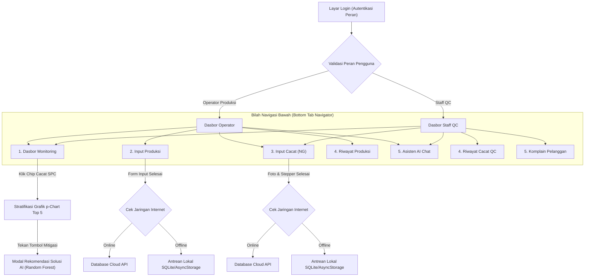

# DESIGN SYSTEM & UI/UX ARCHITECTURE SPECIFICATION
## QC & Production Monitoring Handheld (`qc-mobile-operator`)
**PT Galaxy Mandiri Perkasa — Industrial Stamping & Manufacturing Plant**

---

## 1. PENDAHULUAN & USER PERSONA

### 1.1 Visi Desain
Aplikasi seluler **`qc-mobile-operator`** dirancang untuk mentransformasi operasional pencatatan mutu (*Quality Control*) dan keluaran mesin (*Production Output*) di lantai pabrik (*shop floor*) dari metode manual berbasis kertas menjadi eksekusi digital genggam yang presisi, cepat, dan terpercaya (*real-time & paperless*).

### 1.2 Profil Pengguna Utama (Target Persona)
Desain antarmuka secara spesifik dioptimalkan untuk karakteristik demografis dan lingkungan kerja fisik di PT Galaxy Mandiri Perkasa:
- **Demografi**: Staf QC dan Operator Mesin didominasi oleh personel senior/matang (**usia 38–55 tahun**).
- **Faktor Ergonomi Mata (Presbiopia)**: Penurunan daya akomodasi mata alami pada usia 40+ tahun membutuhkan tipografi yang lebih besar, kontras tajam, serta hierarki visual yang tidak membingungkan.
- **Kondisi Fisik Kerja**:
  - Mengoperasikan ponsel dalam kondisi tangan memakai **sarung tangan kerja pabrik** (bahan katun / *PU-coated gloves*).
  - Bekerja di area mesin cetak logam (*metal stamping press*) dengan pencahayaan bengkel bervariasi, debu industri, dan kebisingan mesin.
  - Membutuhkan antarmuka yang cepat (*fast-tap*), minim ketukan salah (*fat-finger proof*), dan bebas dari elemen dekoratif yang tidak fungsional.

---

## 2. PRINSIP UTAMA DESAIN (CORE DESIGN PRINCIPLES)

```
       +-------------------------------------------------------+
       |             4 PILAR DESAIN QC-MOBILE                  |
       +-------------------------------------------------------+
       | 1. Presbyopia-Friendly (Font >= 12px, KPI 28px)       |
       | 2. Monochromatic Numbers (No Rainbow Text)            |
       | 3. Glove-Friendly Targets (Min Touch Height 46-56px)  |
       | 4. Bento Grid Precision (8pt Grid, Dual Theme)        |
       +-------------------------------------------------------+
```

### 2.1 Presbyopia-Friendly Typography (Tipografi Ramah Mata)
- **Aturan Baku**: **TIDAK ADA HURUF MIKRO DI BAWAH 12px** di seluruh aplikasi.
- Seluruh angka metrik KPI dibuat mencolok dengan ukuran **28px (Font Weight: `900`)** sehingga tetap terbaca jelas dari jarak lengan kerja (60–80 cm) saat ponsel diletakkan di dudukan mesin atau dipegang satu tangan.
- Keterangan penjelas, tanggal, dan label sekunder minimal **12px–13px** dengan kontras memenuhi rasio WCAG AAA.

### 2.2 Monochromatic Number Discipline (Disiplin Warna Angka)
- **Masalah Sebelumnya**: Kartu metrik menggunakan warna campur aduk (merah pada angka temuan NG, hijau pada angka produk lolos, biru pada output, dan oranye pada defect rate) yang menyebabkan kelelahan visual (*visual clutter / rainbow text*).
- **Standar Desain Baru**:
  - Seluruh angka nilai metrik kartu wajib menggunakan warna monokromatik tegas **`textPrimary`** (Hitam pekat pada Light Mode / Putih bersih pada Dark Mode).
  - Seluruh label kategori dan satuan (`pcs`, `%`, `Target`) menggunakan warna **`textSecondary`** (Slate-600 / Slate-400).
  - Warna semantik (**Emerald Green `#10B981`**, **Crimson Red `#EF4444`**, **Amber Orange `#F59E0B`**) **HANYA** boleh diaplikasikan pada:
    1. Lencana status kecil (*Status Badge Pills*, contoh: "Kualitas Baik", "Below Target").
    2. Garis batang progres (*Progress Bar Track & Fill*).
    3. Garis batas statistik diagram kendali SPC (UCL Merah, CL Biru, LCL Hijau).

### 2.3 Glove-Friendly Touch Targets (Target Sentuh Sarung Tangan)
- Tombol aksi utama, tab segment, chip pemilih cacat, dan dropdown selector memiliki tinggi minimal **46px – 56px**.
- Tombol stepper kuantitas ($+$ dan $-$) berukuran **52px × 52px** dengan jarak sela (*gap*) minimal **12px** untuk mencegah salah tekan.
- Lembar pemilihan data tidak menggunakan pemilih bawaan OS yang sempit, melainkan *Bottom Sheet Modal* berpencari dengan item yang memiliki tinggi baris luas (padding 14px).

### 2.4 Bento Grid & Spatial Precision (Tata Letak Bento Modular)
- Mengadopsi struktur kisi Bento (*Bento Grid Layout*) terinspirasi dari standar desain industri modern (Linear & 21st.dev).
- Setiap blok informasi dibungkus kartu bersudut membulat halus (`borderRadius: 16px`) dengan garis pembatas kontras tipis (`borderWidth: 1px / 1.5px`).
- Menggunakan sistem spasi berbasis kelipatan 8-point grid (8, 12, 16, 24, 32px) untuk menjamin responsivitas pada layar ponsel Android 5.5 inci hingga 6.7 inci.

---

## 3. SISTEM TOKEN DESAIN (DESIGN TOKENS)

### 3.1 Palet Warna (Color System)

| Token Warna | Nilai Dark Mode | Nilai Light Mode | Peruntukan Fungsional |
|:---|:---:|:---:|:---|
| `background` | `#0B0F17` | `#F8FAFC` | Latar belakang kanvas aplikasi |
| `card` | `#111827` | `#FFFFFF` | Latar kartu Bento, modal sheet, dan container form |
| `cardSubtle` | `#1E293B` | `#F1F5F9` | Latar sekunder, search bar, dan ribbon mini KPI |
| `border` | `rgba(255,255,255,0.12)` | `#E2E8F0` | Garis pembatas kartu, input, dan divider |
| `textPrimary` | `#F8FAFC` | `#0F172A` | Judul, angka metrik utama, nilai input form |
| `textSecondary`| `#94A3B8` | `#475569` | Label kolom, subjudul kartu, satuan metrik |
| `textMuted` | `#64748B` | `#94A3B8` | Placeholder, tanggal sekunder, informasi copyright |
| `primary` | `#2563EB` | `#2563EB` | Aksi utama, brand identity, CL garis SPC |
| `success` | `#10B981` | `#059669` | Status "In-Control", "On Target", LCL limit |
| `critical` | `#EF4444` | `#DC2626` | Status "Out-of-Control", "Below Target", UCL limit |
| `warning` | `#F59E0B` | `#D97706` | Peringatan batas toleransi, status lokal offline |

### 3.2 Skala Tipografi (Typography Scale)
*Diimplementasikan pada: `src/theme/typography.js`*

```javascript
typography = {
  sizes: {
    kpi: 28,            // Nilai angka hero KPI (Weight: 900, LineHeight: 34px)
    h1: 22,             // Judul halaman utama
    h2: 19,             // Judul seksi & subheader grafis
    h3: 17,             // Judul modul & kartu besar
    screenHeading: 19,  // Header atas layar
    cardHeading: 16,    // Nama mesin, judul kartu (Weight: 800)
    body: 14,           // Teks konten, nilai form, item dropdown (Weight: 600/700)
    caption: 13,        // Subjudul, catatan inspeksi, tanggal
    micro: 12,          // Lencana status, label chip, batas terkecil aplikasi (Weight: 700)
  }
}
```

### 3.3 Sistem Radius & Elevasi

```
+-------------------------------------------------------------+
| Token Radius | Ukuran | Penggunaan                          |
+-------------------------------------------------------------+
| radius-sm    | 6px    | Lencana status mini, tag part number|
| radius-md    | 10px   | Chip filter cacat, tombol tab       |
| radius-lg    | 14px   | Kolom input teks, stepper kuantitas |
| radius-xl    | 16px   | Kartu Bento, kartu mesin, dialog    |
| radius-2xl   | 24px   | Lembar modal bawah (Bottom Sheet)   |
| radius-full  | 999px  | Progress bar, avatar, status pill   |
+-------------------------------------------------------------+
```

---

## 4. SPESIFIKASI KOMPONEN UTAMA (COMPONENT SPECIFICATIONS)

### 4.1 Bento KPI Card (`KpiCard.js`)
- **Struktur Tiga Baris**:
  - *Baris 1*: Status Breathing Dot (8px $\times$ 8px) + Label Kategori UPPERCASE (12px `700`) + Ikon Lucide transparan.
  - *Baris 2*: Angka Metrik Utama (28px `900` monokromatik) + Satuan Inline (13px `600`).
  - *Baris 3*: Sub-badge performa mini (tinggi 24px, padding 8px, font 12px `800`).
- **Dimensi**: Lebar `48.5%` (Grid 2 kolom), `minHeight: 118px`, `padding: 14px`.

### 4.2 SPC Control Chart Component (`SpcControlChart.js`)
- **Header Kendali Mutu**: Ikon aktivitas + Judul SPC Control Chart (16px `800`) + Lencana status real-time `IN-CONTROL` (Hijau) atau `OUT-OF-CONTROL` (Merah).
- **Dynamic Pareto Top 5 Defect Cards & Stratification**:
  - **Header Strip Top 5**: Label "TOP 5 PARETO CACAT" + Total akumulasi temuan cacat (pcs) + Petunjuk navigasi geser ("Geser & Pilih →").
  - **Horizontal Defect Cards**: Kartu modular (`minHeight: 70px`, `minWidth: 152px`, `borderRadius: 14px`) yang ramah jari sarung tangan dengan umpan balik taktil pegas (*spring tactile scale* `0.97`).
  - **Pewarnaan Tingkat Keparahan Pareto (Severity Tiering)**:
    * Rank `#1 UTAMA`: Aksen Crimson Red (`#EF4444`) untuk cacat penyumbang limbah terbanyak (Pareto 80/20).
    * Rank `#2 WASPADA`: Aksen Amber Warning (`#F59E0B`).
    * Rank `#3`: Aksen Sky Blue (`#0EA5E9`).
    * Rank `#4 & #5`: Aksen Purple/Slate (`#8B5CF6` / `#64748B`).
  - **Bilah Gauge Mikro (Micro Proportion Track)**: Setiap kartu memiliki garis kemajuan mikro 4px di bagian bawah yang merefleksikan persentase kontribusi Pareto secara visual real-time.
  - **Lencana Ceklis Aktif**: Kartu yang aktif memiliki elevasi bayangan bertepuk (`shadowOpacity: 0.35`, `elevation: 4`), teks putih kontras tinggi, dan ikon ceklis (`Check`) bercahaya.
  - **Bilah Umpan Balik Kontekstual Dinamis (Active Context Banner)**: Menampilkan nama cacat yang sedang difokuskan, persentase Pareto, jumlah mesin terdampak yang terisolasi, serta tombol instan "Reset" untuk kembali ke seluruh cacat.
  - **Status Zero Defect**: Menampilkan kartu pelindung hijau jika tidak ada temuan cacat pada periode yang dipilih.
- **Bento Bar Batas Kendali Statistik (3-Sigma Limits)**:
  - Tiga pil komparasi: **UCL** (Merah), **CL / $\bar{p}$** (Biru), dan **LCL** (Hijau) dengan tinggi 44px dan angka proporsi 14px `800`.
- **Kanvas Grafik SVG Interaktif**:
  - Menghubungkan titik subgroup fraksi cacat ($p_i$) secara dinamis.
  - Sumbu X menampilkan indeks subgroup tanpa tumpang tindih (*anti-collision layout*).

### 4.3 Kartu Status Mesin Harian (`DashboardScreen.js`)
- **Header**: Ikon mesin/kualitas + Nama Mesin (16px `800`) + Proses + Status Pill (`Kualitas Baik` vs `Perlu Investigasi` atau `On Target` vs `Below Target`).
- **4 Kolom Metrik Bersih**:
  - *Staff QC*: Output Mesin, Temuan NG, Defect Rate, Produk Lolos.
  - *Operator*: Target Mesin, Hasil Kotor (Gross), Temuan Cacat (NG), Produk Bersih (Net OK).
  - *Standar Visual*: Seluruh nilai angka menggunakan 15px `800` warna `textPrimary` dan label 12px `textSecondary`.
- **Bilah Toleransi & Yield Mutu**:
  - Track horizontal tinggi 8px bersudut melingkar penuh (*pill track*).
  - Warna baris mengikuti status mutu mesin disertai teks persentase dan batas toleransi maksimal 2.0%.

### 4.4 Stepper Kuantitas Taktil (`InputDefectScreen.js`)
- **Ergonomi Jari Pekerja**: Tombol minus $(-)$ dan plus $(+)$ berukuran **52px $\times$ 52px** dengan border 1.5px.
- **Display Angka Tengah**: Menampilkan kuantitas cacat berukuran raksasa **32px Font Weight 900** untuk konfirmasi visual instan sebelum disimpan.

---

## 5. STRUKTUR NAVIGASI & ALUR KERJA (APPLICATION FLOW)



---

## 6. STANDAR AKSESIBILITAS (A11Y) & POKA-YOKE LAPANGAN

1. **Pencegahan Kesalahan Input (Poka-Yoke System)**:
   - Nilai kuantitas input dibatasi secara logis (kuantitas NG tidak boleh melebihi total produksi; nilai minus diblokir otomatis).
   - Terdapat konfirmasi visual langsung (*Live Achievement Meter*) saat operator memasukkan kuantitas target dan aktual.
2. **Umpan Balik Haptik & Sentuhan (Sensory Feedback)**:
   - Komponen `SpringButton` memberikan umpan balik skala animasi (*scale spring down to 0.96*) saat tombol ditekan sehingga operator yang memakai sarung tangan merasakan kepastian bahwa sentuhan telah teregister.
3. **Integritas Sinkronisasi Offline**:
   - Status koneksi data disajikan transparan menggunakan lencana status:
     * Lencana **`Cloud`** hijau dengan ikon ceklis: data tersimpan aman di server pusat.
     * Lencana **`Lokal`** kuning dengan ikon jam: data tersimpan di memori offline perangkat dan siap sinkron otomatis begitu sinyal Wi-Fi terdeteksi.

---

## 7. KESIMPULAN ARSITEKTUR

Desain sistem aplikasi mobile **`qc-mobile-operator`** mengintegrasikan keindahan arsitektur antarmuka digital modern (*Bento Grid*) dengan ketegasan disiplin manufaktur Jepang (*Monozukuri & Six Sigma*). Standar tipografi presbiopia, target sentuhan ergonomis sarung tangan, dan penyeragaman angka monokromatik menjamin bahwa aplikasi ini tidak hanya modern secara visual, namun terbukti tangguh, ramah pengguna, dan efektif digunakan oleh pekerja senior di lini perakitan pabrik PT Galaxy Mandiri Perkasa.
